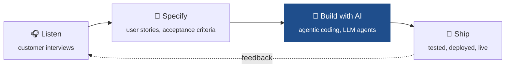

📍 Darmstadt, Germany &nbsp;·&nbsp; 🎓 Master's student, TU Darmstadt (NLP) &nbsp;·&nbsp; 🗣️ English C1 · German B1
 
<b>Open to working-student roles and internships</b> · available now · on site, hybrid or remote

---

### 🧭 How I work

| 🛫 **100s** | 🗣️ **10** | 📐 **92** | 🧪 **137** |
|:--:|:--:|:--:|:--:|
| passengers helped daily at Frankfurt Airport | customer interviews | product decisions in one blueprint | automated tests per release |

---

### 🚀 Selected work

<table>
<tr>
<td width="50%" valign="top">

#### 🌐 [adensasupply.com](https://adensasupply.com)
 

Website for **Adensa Supply & Logistics Ltd**, a registered building-materials company in Ghana. Led end to end, from requirements to release.

- 11-page, mobile-first, accessible site
- Serverless form API: Turnstile bot protection, origin checks, server-side validation, reference IDs, email confirmations
- Privacy notice and data-retention rules
- Automated checks, preview releases and a user-story backlog
- [Case study](https://selasey-gbeddy.vercel.app/#story-website) · [Figma design file](https://www.figma.com/design/RWoi6UAbZ8PRmGOdvzmRNe/adensasupply.com-%C2%B7-Product-Design-File?node-id=11-18) · [Design repo](https://github.com/Selaseyjr/adensasupply-product-case-study)

`HTML` `CSS` `JavaScript` `Cloudflare Pages` `Workers`

</td>
<td width="50%" valign="top">

#### 📦 [AdensaOps](https://adensaops.com) · [code](https://github.com/Selaseyjr/adensa-ops) · [Figma](https://www.figma.com/community/file/1700529335374306054) · [design repo](https://github.com/Selaseyjr/adensaops-product-design)
 

Operations platform demo: suppliers, CRM, quotes, a six-stage order pipeline, cash ledger and KPI dashboard.

- Specified from 10 customer interviews
- Business rules in the data model: 14-day price staleness, deposit before order
- Tests block every failing release

`React 19` `TypeScript` `Tailwind` `Workers + D1`

</td>
</tr>
<tr>
<td width="50%" valign="top">

#### 🤖 AI job-search agent
 

A scheduled agent pipeline: web search, filters for role, location, commute and language, LLM scoring against my CV, and the top 20+ roles delivered to my phone.

`Hermes Agent` `LLM` `cron` `Telegram Bot API`

</td>
<td width="50%" valign="top">

#### ✨ [Portfolio](https://selasey-gbeddy.vercel.app)
 

Hand-coded portfolio in warm cream with neon kente accents: moving airport photography, playful pointer and tap effects, business case studies and an "Ask my agent" command bar.

`HTML` `CSS` `JavaScript` `Vercel`

</td>
</tr>
</table>

---

### 🧰 Toolbox

**Product** &nbsp;

**AI & automation** &nbsp;

**Data** &nbsp;

 

<b>🎓 Experience & education</b>

 

| When | |
|:--|:--|
| 08/2026 – today | **Digital Product Lead**, Adensa Supply & Logistics Ltd (remote, part-time) |
| 10/2024 – today | **M.A. Data and Discourse Studies**, TU Darmstadt · NLP, Python, corpus analysis |
| 01 – 07/2026 | **Data Analytics Bootcamp**, Ironhack · Python, SQL, Tableau, ML, A/B testing |
| 09/2026 | **The Complete Web Developer Course 3.0**, Udemy |
| 06/2025 – 01/2026 | **Customer Service Agent**, FRASEC, Frankfurt Airport · mainly in German |
| 11/2022 – 12/2023 | **IT Applications Support**, Ghana Airports Company Ltd |
| 2018 – 2022 | **B.Sc. Administration**, University of Ghana |

---

> *I turn how businesses really run into working products.*

📬 <a href="https://selasey-gbeddy.vercel.app/#contact">Get in touch through my portfolio</a>

