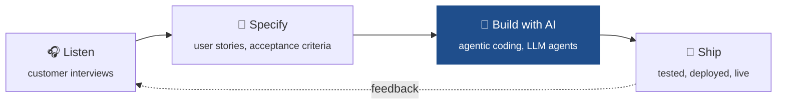
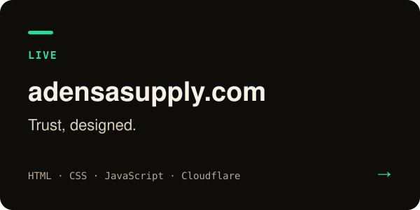
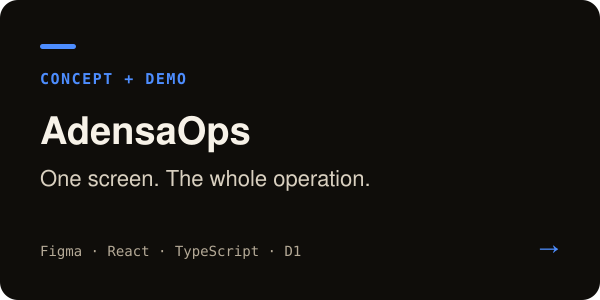
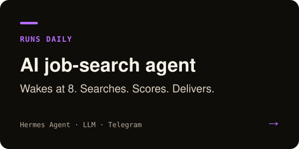
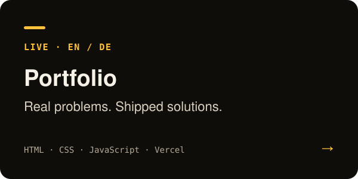

&nbsp;&nbsp;&nbsp;&nbsp;&nbsp;&nbsp;&nbsp;&nbsp;&nbsp;&nbsp;&nbsp;&nbsp;

Darmstadt · Open to working-student roles

---

### 🧭 How I work

| 🛫 **100s** | 🗣️ **10** | 📐 **92** | 🧪 **137** |
|:--:|:--:|:--:|:--:|
| passengers helped daily at Frankfurt Airport | customer interviews | product decisions in one blueprint | automated tests per release |

---

### 🚀 Selected work

---

### 🧰 Toolbox

**Product** &nbsp;

**AI & automation** &nbsp;

**Data** &nbsp;

 

<b>🎓 Experience & education</b>

 

| When | |
|:--|:--|
| 08/2026 – today | **Digital Product Lead**, Adensa Supply & Logistics Ltd (remote, part-time) |
| 10/2024 – today | **M.A. Data and Discourse Studies**, TU Darmstadt · NLP, Python, corpus analysis |
| 01 – 07/2026 | **Data Analytics Bootcamp**, Ironhack · Python, SQL, Tableau, ML, A/B testing |
| 09/2026 | **The Complete Web Developer Course 3.0**, Udemy |
| 06/2025 – 01/2026 | **Customer Service Agent**, FRASEC, Frankfurt Airport · mainly in German |
| 11/2022 – 12/2023 | **IT Applications Support**, Ghana Airports Company Ltd |
| 2018 – 2022 | **B.Sc. Administration**, University of Ghana |

---

> *Real problems. Shipped solutions.*

📬 <a href="https://selasey-gbeddy.vercel.app/#contact">Get in touch through my portfolio</a>

